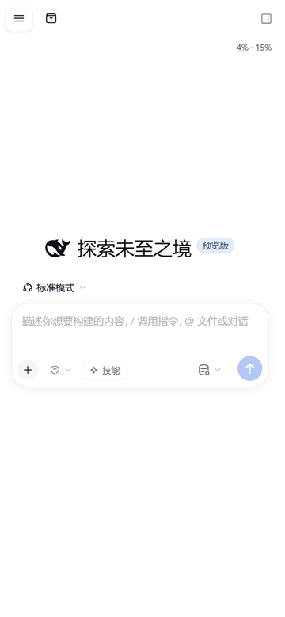

# dsh-mobile-studio

> **In English** — Drive your desktop AI coding agent from your phone: a LAN gateway plugin for DeepSeek Harness plus an Android shell app. Send prompts, watch tasks run, open terminals and files, and get a notification when the task finishes — from bed, without sitting at the desk.
> Install: `dsh plugin install dsh-mobile-studio` · Android APK: [latest release](https://github.com/lexin2002/dsh-mobile-studio/releases/latest)
> Not affiliated with DeepSeek. Built with DeepSeek models inside DeepSeek Harness.



_手机浏览器打开网关页：敲一句指令、看它跑完、回答里的代码块直接渲染（9 秒，无剪辑）。_

让 DeepSeek Harness（DSH）在手机上真正可用：**一个 Cordis 插件（电脑端）+ 一个安卓壳 App**。

> **非官方项目**：这是个人项目，与 DeepSeek 官方无关，也没有得到官方背书。应用图标与提示音目前为自绘/占位素材，正式上架应用商店前会再做替换；如果你要二次分发，请自行确认素材授权。

最核心的用法只有一句话：**躺在床上用手机控制 DSH 的大部分功能**——发消息、看任务跑到哪、切会话、翻工作区文件、开终端、批准计划、收完成通知。不用坐到电脑前，也不用把笔记本端到床边。

插件做两件事：

1. 在局域网起一个网关（默认 `3081`），把只监听 `127.0.0.1` 的桌面板 DSH 暴露给手机；
2. 往 DSH 网页里注入一套「手机形态」的界面（左栏抽屉、返回键分层、输入法与指令菜单、终端/文件面板等）。

App 是 WebView 壳：扫码或填地址连上电脑，后台保持推送长连接，任务结束时弹系统通知，支持扫码、相册选图、附件上传。

> 这个项目靠 DSH 官方页面的 `data-slot` 锚点与插件槽位工作，**不是** DSH 官方功能。DSH 升级后可能出现界面错位（锚点漂移），这是已知代价。

## 手机上具体能做什么

- **发消息、看流式回答**：和电脑上是同一个会话、同一份上下文，代码块、表格、终端输出都能正常渲染。
- **左栏**：点左上角出会话列表与工作区，点一条直接切过去；点空白处、再点一次按钮，或者按返回键都能收起。
- **右栏**：终端、文件、任务面板从右侧滑出，看文件、看命令输出、批准计划都在这里。
- **返回键是分层级的**：面板开着时按返回先关面板，在会话里按返回回上一层，都没有了才提示退出——不会一下就退出整个 App。
- **`/` 命令与 `@` 文件**：输入 `/` 弹指令菜单，输入 `@` 引工作区文件，和桌面端一样。
- **附件**：点 `+` 出「相册 / 拍照 / 文件」，选完直接进草稿栏；缩略图能单删，传失败了会重试。
- **键盘、指令菜单、附件面板三者互斥**：同一时间只会存在一个——弹键盘就收面板，点面板就收键盘，不会出现两层东西叠在一起把输入框挡住。
- **任务完成通知**：任务跑完手机弹系统通知，点通知直接跳回那个会话。

## 这个项目是怎么写出来的

代码、界面、测试、打包脚本、排障过程，**全部由 DeepSeek 模型在 DeepSeek Harness 里生成与迭代**；作者负责提需求、做取舍、在真机上验收。

## 兼容插件（默认放行）

有些第三方插件会往界面里塞元素，手机上容易顶坏布局。下面这些经过实测，**不影响移动端 UI 与既有功能**，所以默认放行（在「移动端访问 → 放行白名单」里可以看到并随时关闭）：

| 插件 | 说明 |
|---|---|
| `dsh-curator` | 插件与上下文整理 |
| `dsh-opencode-go-server-error-retry` | 服务错误自动重试 |

名单外的第三方插件不会被下发到手机（网关层过滤，不是隐藏）：想在手机上用，到白名单里手动勾上即可；勾上的会自动排到列表最前面，方便随时关掉。

> 说明：过滤只影响手机端，电脑端照常加载所有插件。


## 目录

```
index.js         插件入口：注册 fetch 接口、启动网关、注入配置
lan.js           局域网网关：/m 手机页、鉴权、SSE 推送、二维码登录
client.js        DSH 客户端插件：设置面板「移动端访问」、扫码面板
mobile/          mobile.js + mobile.css：手机形态界面
mobile-filter.js 插件/会话过滤
auth.js          访问密码、HMAC 登录票据、配置文件
push-events.js   任务完成事件流（SSE 与轮询共用）
qr-inline.js     二维码生成（内联，无外网依赖）
android/         安卓壳 App（Java + 自绘资源，无 Gradle）
tools/           测试、检查与打包脚本
```

## 需要什么

| 依赖 | 说明 |
|---|---|
| DSH | 桌面版，插件需放进 DSH 的插件目录并启用 |
| Node.js | ≥ 20（插件与网关） |
| JDK 17 | 只有构建 APK 需要 |
| Android SDK | `platforms/android-34` + `build-tools/34.0.0` |

## 安装插件

把本仓库放到 DSH 的插件目录（或建一个符号链接），然后在 DSH 的插件配置里启用 `dsh-mobile-studio`。

插件带的 `cordis.patch.yml` 只是声明一个 `mobile-studio` 条目，实际启用要看你的 DSH 组合配置。

重载 DSH 后，网页右侧设置里会出现「移动端访问」：显示二维码、可开关访问密码。

## 手机访问

1. 电脑与手机在同一个局域网；
2. 设置面板「移动端访问」里生成二维码（带登录票据，手机扫码不用手打密码）；
3. 手机 App 扫码 → 打开 `http://<电脑IP>:3081/m`；
4. 手动填地址也可以：只填 IP 或 `IP:端口` 都行，会自动补 `/m`。

**安全提醒**：网关只适合可信局域网。开了访问密码也仍然是明文 HTTP，不要在公共 Wi-Fi 或公网暴露这个端口。

## 构建 APK

```powershell
# 需要 JAVA_HOME 指向 JDK 17；Android SDK 用 ANDROID_SDK_ROOT
powershell -NoProfile -ExecutionPolicy Bypass -File tools\build-apk.ps1 -VersionName 0.9.16 -VersionCode 49
```

- 签名密钥默认放 `%USERPROFILE%\.dsh\mobile-app\dsh-mobile.keystore`，首次运行会自动生成；也可以用 `-Keystore` / `-KeystorePassFile` 指定。
- **升级必须用同一把钥匙**，否则手机上覆盖安装会失败（需要先卸载）。
- 想用你自己的签名：删掉那对文件后重新构建，或直接传参。
- `tools/make-icon.py` 需要一张源图（`--src` 或环境变量 `DSH_ICON_SRC`）；没有就沿用仓库里已有的 `mipmap` PNG。

## 测试

```bash
node tools/test-app-recovery.mjs   # App 自愈结构（探针/横幅/登录/悬浮球/返回键）
node tools/test-fab-model.mjs      # 悬浮球可见性时间轴
node tools/test-push-events.mjs    # 推送事件缓冲与补发
node tools/test-push-sse.mjs       # SSE 断线补发（真起网关）
node tools/test-push-native.mjs    # 安卓推送侧静态断言
node tools/test-gateway.mjs        # 网关鉴权 / 二维码票据
node tools/check-css-anchors.mjs   # CSS 锚点纪律
```

这些脚本无需手机、也无需 DSH 在线（少数需要本地临时端口）。

## 欢迎提问题

用着不对劲、某个插件在手机上把界面顶坏了、或者 DSH 升级后哪块错位了，都欢迎开 Issue：带上手机型号、DSH 版本、截图（能附上「移动端访问 → 诊断」里那段文本最好），比“用不了”三个字有用得多。

## 许可

MIT，见 [LICENSE](LICENSE)。
